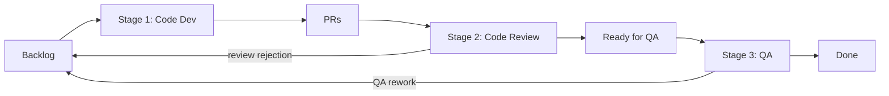

# Queuing Theory Simulator

**What happens to the system when we optimize some parts of software delivery and not the entire value chain?**

AI coding agents are making one part of software delivery (writing code) dramatically faster. Software delivery is a system, though, not a single step. Work still has to be prioritized, reviewed, tested and shipped. Queuing theory tells us that speeding up one stage of a system does not speed up the system unless that stage was the constraint. Usually the work just piles up somewhere else.

This simulator makes that visible. It models a delivery value chain as a series of queues and stages, and lets you watch what happens to flow, queues and lead time as agents are introduced and different parts of the chain become the bottleneck.

## The value chain being modelled



- **Backlog**: work that product has asked for but nobody has started.
- **Stage 1, Code Dev**: writing the code. This is the stage agents accelerate first.
- **PRs**: finished code waiting for a reviewer.
- **Stage 2, Code Review**: a human reviewing the change. Rejected changes go back to the backlog.
- **Ready for QA**: approved changes waiting to be tested.
- **Stage 3, QA**: testing. Failed items go back to the backlog as rework.
- **Done**: shipped.

Each stage has a number of servers (people or agents working in parallel) and a service rate (items one server finishes per day). Work arrives at the arrival rate.

## Scenarios

The scenarios are designed to be explored as a story: start from a healthy traditional team, introduce agents, then see where the constraint moves.

Utilization is how busy a stage is: arrivals divided by capacity. Anything at or above 100% can never catch up, and its queue grows without bound. Queues also grow sharply well before 100%, which is why the healthy scenarios sit around 60%.

| Scenario | Arrivals/day | Code Dev | Code Review | QA | Utilization (Dev / Review / QA) |
|---|---|---|---|---|---|
| Healthy Traditional Flow | 1.2 | 3 x 0.7 | 1 x 2.0 | 1 x 2.0 | 57% / 60% / 60% |
| The Product Bottleneck | 3.0 | 3 x 0.7 | 1 x 2.0 | 1 x 2.0 | 143% / 150% / 150% |
| The QA Bottleneck | 2.5 | 3 x 1.2 | 2 x 2.0 | 1 x 1.5 | 69% / 63% / 167% |
| Agentic Development | 1.2 | 3 x 4.0 | 1 x 2.0 | 1 x 2.0 | 10% / 60% / 60% |
| Code Review Bottleneck | 5.0 | 2 x 4.0 | 3 x 1.5 | 2 x 4.0 | 63% / 111% / 63% |

Stage columns are written as servers x service rate per day. All scenarios turn off blocking, rework, review rejection and whale tasks so the effect of capacity alone is visible. You can add that friction afterwards with the sliders.

### Healthy Traditional Flow

The baseline, and what the app opens on. A traditional team where coding is the slowest per-person activity (0.7 items a day each), review and QA keep up, and every stage has about 40% slack. Queues stay short and lead time is a few days.

### The Product Bottleneck

The same healthy team, but product asks for more than the system can finish. No stage can keep up, so the backlog grows without bound. Faster coding alone would not fix this; the downstream stages are also over capacity. This is the pressure that often motivates adopting agents in the first place.

### The QA Bottleneck

Plenty of development and review capacity, but a single QA server that can only test 1.5 items a day against 2.5 arriving. Work flows smoothly through coding and review, then piles up in Ready for QA. Adding more developers or agents here makes the pile bigger, not the output.

### Agentic Development

The healthy team with code dev raised to the maximum service rate, as if agents were writing the code. Lead time drops because each item spends far less time being coded. Throughput does not change: the team still finishes only what arrives, and review and QA are exactly as busy as before. The time saved in coding is real, but it is not more delivery.

### Code Review Bottleneck

What agentic delivery tends to look like at scale. Code dev and QA are both fast (agents writing code and automated tests), and demand rises to 5 items a day. Human code review becomes the constraint at 111% utilization, and the PRs queue grows without bound while QA sits partly idle. The bottleneck has moved from writing code to reading it.

## Reading the screen

- **Dots** are work items. Green is flowing, yellow has been waiting in a queue for more than a day, red is blocked, and blue is rework that was sent back. Larger dots are whale tasks (5x the normal size).
- **Circles in each stage** are servers. A filled circle is busy; an empty circle marked S is idle slack.
- **Queues** resize as work piles up. The Backlog turns red above 50 items, and PRs and Ready for QA turn red above 30.
- **Metrics** show items done, WIP against the WIP limit for each stage, flow efficiency (time being worked on divided by total lead time), the most utilized stage and which stage is the bottleneck, theoretical and actual lead time, and throughput per sprint (10 days).
- **Queue Pressure by Stage** charts each stage's WIP as a percentage of its WIP limit over time.

## Controls

- **Scenarios**: load a scenario's settings. By default the simulation keeps running from where it is, so you can watch the system move from one state to another. Tick "Reset simulation when switching" to start each scenario from empty.
- **Incoming Flow**: arrival rate and simulation speed.
- **Team Capacity**: servers, service rate and WIP limit for each stage.
- **System Friction**: blocking in code dev, review rejection rate and QA rework rate.
- **Work Variability**: whale mode, where some tasks are 5x the normal size.
- **Play, pause, reset and the legend** are in the top right of the canvas. Elapsed time in sprints is in the top left.

## Model assumptions

- Arrivals and service times are random (exponentially distributed), so each stage behaves like an M/M/c queue. Two runs with the same settings will not be identical.
- Theoretical lead time adds up the M/M/c time in system for each stage for a single pass. It does not account for repeated passes caused by rework, so with rework turned on the actual lead time will be higher.
- Utilization accounts for the extra load rework and review rejection put on each stage.
- Blocked items hold their code dev server until they are unblocked.

## Running it

Requires Node.js 20.19+ or 22.12+.

```bash
npm install
npm run dev      # start the dev server
npm run build    # type-check and build to dist/
npm run lint     # run oxlint
```

## Project structure

- `src/sim/engine.ts`: the simulation (queues, servers, routing, metrics).
- `src/sim/scenarios.ts`: default settings and the scenario definitions.
- `src/sim/useSimulation.ts`: React hook that runs the simulation loop.
- `src/components/SimCanvas.tsx`: the value chain diagram.
- `src/components/PressureChart.tsx`: the queue pressure chart.
- `src/components/Sidebar.tsx`: metrics and controls.

Built with React, TypeScript and Vite.
